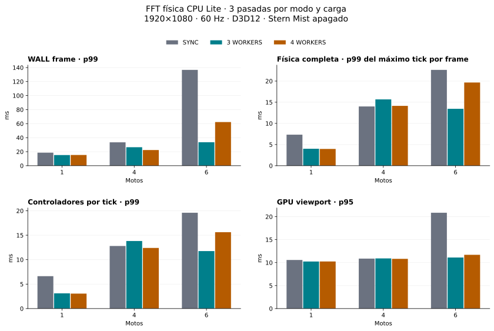

# FFT física CPU Lite: comparación SYNC / 3 / 4 trabajadores

19 de octubre de 2026 · Ocean Production · base `081dd40` · rama `codex/async-fft-lite-workers`.

## Decisión

**Decisión de producción: continuar síncrono. Mejor candidato experimental: ASYNC_3_WORKERS.** Con seis motos, tres trabajadores ofrecen el mejor p95/p99 agregado de frame y física completa observada. Cuatro ayudan con cuatro motos, pero su tercera pasada de seis motos empeora notablemente. No se atribuye esto exclusivamente a Jolt, afinidad o throttling: no hay medición por núcleo que permita demostrar esa causa.

Con seis motos, el p99 de WALL pasa de **136,672 a 33,453 ms** y el p99 del máximo tick físico completo por frame de **22,645 a 13,444 ms**. Son reducciones observadas de 75.5% y 40.6%. No equivalen a una garantía de 60 FPS: tres trabajadores dan 49,90 FPS medios y mínimo sostenido de 32,11 en este banco.

La suite determinista de fuerzas y trayectoria coincide, pero **no se afirma identidad binaria universal del mar entre historias de cálculo distintas**: el control de estados locales precalculados frente a demanda detecta 11 diferencias Float32, con error double inferior a 8e-12. Esta limitación impide declarar cerrada una garantía absoluta de mar idéntico en cualquier historia; por ello no se activa automáticamente el modo experimental.

## Condiciones y metodología

- i7-13650HX, 14 núcleos / 20 procesadores lógicos; RTX 4070 Laptop. Godot 4.7.1 `a13da4feb`, Jolt, Forward+, D3D12, ventana y viewport verificados a 1920×1080, física 60 Hz, límite 144 FPS. Afinidad intacta.
- 27 ejecuciones completadas sin error: 1/4/6 motos × tres modos × tres pasadas. Orden por pasada: SYNC→3→4, 4→SYNC→3, 3→4→SYNC. Calentamiento 8 s; estabilización 0,5 s por caso.
- Seis posiciones mantenidas 2 s: exterior, interior/feather de ambos estados y solapamiento; cruce X 4 s, cruce longitudinal 14 s y salto/aterrizaje 3 s. Cada modo recorre los mismos casos. El banco de rendimiento controla posiciones para repetir la carga; el replay de paridad separado deja evolucionar fuerzas y cuerpos.
- Escena real `validation/hull_wave_physics_playground.tscn`, SHA256 `29a1fb5bc3cadff21721918b8127c2674f40ae61f30accc51f904878b20169e6`. La escena guardada tiene una zona activa: el banco añade una segunda huella **solo en memoria**, idéntica en A/B/C, para probar dos estados y solapamiento. No se ha guardado ni modificado la escena por este trabajo.
- Stern Mist desactivado mediante copias privadas de sus estilos, con emisión/render desactivados y verificados en todos los casos. Ocultarlo solamente no bastaba. No se modifican sus recursos de producción.
- Solo `temp/async_fft/real_profiler/` es la cohorte canónica de tiempos. Se descartan capturas exploratorias anteriores por cronómetros inclusivos o emisión Mist todavía activa.
- WALL mide intervalos reales entre frames; percentiles interpolados linealmente sobre muestras agrupadas, sin promediar percentiles. FPS medio = frames / tiempo WALL; mínimo sostenido = mínimo de ventanas consecutivas de aproximadamente un segundo dentro de cada caso.
- Física completa procede de `EngineProfiler._tick`: incluye callbacks de controlador, sincronización/consultas PhysicsServer y paso Jolt. Entrega **el máximo tick completo por iteración renderizada**, junto al número de pasos. En frames con varios pasos no proporciona cada duración individual. La tabla principal describe esa distribución de máximos; la tabla adicional muestra solo frames de un paso. No se presenta el monitor `TIME_PHYSICS_PROCESS` (máximo actualizado cada segundo) como distribución de ticks.
- Se filtra por los IDs de tick medidos. Los ticks del borde cuya notificación llega fuera de la ventana se cuentan explícitamente; no se rellenan. Las duraciones de callbacks Node se conservan aparte en JSON.
- Controlador = suma por tick de los spans externos `controller.integrate`, una vez por moto. No se suman sus etapas inclusivas. El promedio por llamada de cada tick tampoco equivale a percentiles de llamadas individuales.
- La captura utiliza el sink de diagnóstico que ya existía como cambio local del usuario en el proveedor; esas tres líneas se conservan pendientes, fuera de nuestros commits. Para reproducir esa columna desde un checkout limpio se necesita ese sink diagnóstico; el funcionamiento async no depende de él.

Hay una regresión que impide aceptar el resultado como mejora uniforme: con cuatro motos, el p99 de física completa observada pasa de 14,007 ms en SYNC a 15,671 ms con tres (+11,9%) y 14,144 ms con cuatro (+1,0%), aunque mejora el p95 y el WALL. Se conserva esa cola y se mantiene la baseline como modo de producción. Las diferencias numéricas de historias distintas y la cobertura incompleta de duraciones individuales durante catch-up también quedan abiertas.

## Frame y FPS

Todos los tiempos están en milisegundos; los máximos incluyen todos los casos medidos.

| Motos | Modo | WALL p50 | p95 | p99 | Máx | FPS medio | Mín sostenido ~1 s |
|---|---|---|---|---|---|---|---|
| 1 | SYNC | 10.994 | 16.354 | 18.625 | 22.757 | 105.922 | 80.827 |
| 1 | 3 WORKERS | 9.161 | 13.386 | 15.211 | 23.953 | 119.188 | 82.972 |
| 1 | 4 WORKERS | 9.201 | 13.434 | 15.289 | 23.814 | 118.750 | 82.915 |
| 4 | SYNC | 16.476 | 29.646 | 33.380 | 64.925 | 59.393 | 23.519 |
| 4 | 3 WORKERS | 14.810 | 19.291 | 26.352 | 45.246 | 71.746 | 48.411 |
| 4 | 4 WORKERS | 14.756 | 18.809 | 22.352 | 39.237 | 73.154 | 57.385 |
| 6 | SYNC | 33.788 | 105.795 | 136.672 | 213.184 | 24.268 | 5.549 |
| 6 | 3 WORKERS | 17.556 | 31.784 | 33.453 | 60.687 | 49.904 | 32.110 |
| 6 | 4 WORKERS | 17.905 | 45.418 | 62.242 | 94.615 | 44.157 | 14.409 |

## Física completa observada

**Máximo de tick por frame renderizado**, no suma de ticks ni distribución exhaustiva de todos los ticks cuando hay catch-up.

| Motos | Modo | p50 | p95 | p99 | Máx |
|---|---|---|---|---|---|
| 1 | SYNC | 5.647 | 7.026 | 7.337 | 11.227 |
| 1 | 3 WORKERS | 3.372 | 3.790 | 4.005 | 5.500 |
| 1 | 4 WORKERS | 3.357 | 3.780 | 3.963 | 4.324 |
| 4 | SYNC | 10.979 | 12.709 | 14.007 | 30.116 |
| 4 | 3 WORKERS | 8.898 | 10.495 | 15.671 | 23.727 |
| 4 | 4 WORKERS | 8.959 | 10.058 | 14.144 | 22.418 |
| 6 | SYNC | 14.018 | 16.331 | 22.645 | 32.857 |
| 6 | 3 WORKERS | 11.633 | 12.818 | 13.444 | 21.692 |
| 6 | 4 WORKERS | 11.857 | 14.099 | 19.665 | 30.714 |

| Motos | Modo | Muestras completas | Solo un paso: n | Solo un paso: p95 | p99 | Máx pasos/frame | Ticks sin muestra de borde |
|---|---|---|---|---|---|---|---|
| 1 | SYNC | 5932 | 5932 | 7.026 | 7.337 | 1 | 21 |
| 1 | 3 WORKERS | 5932 | 5932 | 3.790 | 4.005 | 1 | 21 |
| 1 | 4 WORKERS | 5935 | 5935 | 3.780 | 3.963 | 1 | 18 |
| 4 | SYNC | 5463 | 5022 | 12.150 | 13.112 | 4 | 32 |
| 4 | 3 WORKERS | 5857 | 5778 | 10.360 | 15.012 | 2 | 23 |
| 4 | 4 WORKERS | 5913 | 5893 | 10.050 | 13.975 | 2 | 21 |
| 6 | SYNC | 2395 | 610 | 13.326 | 13.737 | 8 | 88 |
| 6 | 3 WORKERS | 4838 | 3758 | 12.508 | 12.995 | 3 | 33 |
| 6 | 4 WORKERS | 4289 | 2951 | 12.540 | 13.291 | 5 | 38 |

El subconjunto de un paso no representa los ticks de los frames lentos. En SYNC con seis motos solo incluye 610 muestras; no debe usarse para esconder los episodios de catch-up. La cohorte no permite reconstruir percentiles exactos de **todos** los ticks completos individuales.

## Controladores y GPU

| Motos | Modo | Controladores/tick p50 | p95 | p99 | Máx | GPU viewport p95 | p99 | Máx |
|---|---|---|---|---|---|---|---|---|
| 1 | SYNC | 4.950 | 6.323 | 6.628 | 10.395 | 10.572 | 11.844 | 13.005 |
| 1 | 3 WORKERS | 2.595 | 2.945 | 3.113 | 4.450 | 10.245 | 11.602 | 12.527 |
| 1 | 4 WORKERS | 2.584 | 2.919 | 3.059 | 3.260 | 10.250 | 11.651 | 12.665 |
| 4 | SYNC | 9.962 | 11.776 | 12.800 | 27.588 | 10.870 | 11.893 | 12.608 |
| 4 | 3 WORKERS | 7.635 | 8.989 | 13.814 | 20.856 | 10.915 | 11.891 | 12.607 |
| 4 | 4 WORKERS | 7.625 | 8.586 | 12.397 | 19.600 | 10.821 | 11.801 | 12.551 |
| 6 | SYNC | 12.948 | 14.921 | 19.596 | 30.086 | 20.853 | 26.801 | 37.657 |
| 6 | 3 WORKERS | 10.379 | 11.227 | 11.755 | 19.513 | 11.112 | 11.927 | 12.520 |
| 6 | 4 WORKERS | 10.505 | 12.278 | 15.622 | 28.212 | 11.702 | 13.509 | 15.713 |

Con una y cuatro motos el p95 de viewport permanece próximo entre modos. Con seis, la baseline acumula muchos pasos por frame y también empeora la distribución GPU; no se atribuye toda esa diferencia a un kernel GPU. Cuatro trabajadores tienen p95 GPU mayor que tres con seis motos. Estas observaciones no demuestran equivalencia visual por captura de píxeles.

## Construcción de los campos

Tiempo WALL desde el inicio de la construcción; en async incluye cola y barrera de las tres bandas de ese estado. Los estados se solapan y no se deben sumar estas latencias como coste del hilo físico. En SYNC los locales se construyen bajo demanda; se cuentan solo cambios de tiempo, evitando repetir un perfil cacheado.

| Motos | Modo | Estado | Builds | p50 | p95 | p99 | Máx |
|---|---|---|---|---|---|---|---|
| 1 | SYNC | base | 5953 | 1.168 | 1.291 | 1.373 | 2.148 |
| 1 | SYNC | local0 | 4797 | 1.092 | 1.198 | 1.255 | 2.137 |
| 1 | SYNC | local1 | 2041 | 1.090 | 1.196 | 1.269 | 2.185 |
| 1 | 3 WORKERS | base | 5953 | 0.642 | 0.854 | 1.065 | 1.516 |
| 1 | 3 WORKERS | local0 | 5953 | 1.153 | 1.475 | 1.704 | 2.265 |
| 1 | 3 WORKERS | local1 | 5953 | 1.653 | 1.994 | 2.170 | 3.341 |
| 1 | 4 WORKERS | base | 5953 | 0.670 | 0.928 | 1.175 | 1.714 |
| 1 | 4 WORKERS | local0 | 5953 | 1.203 | 1.421 | 1.589 | 1.982 |
| 1 | 4 WORKERS | local1 | 5953 | 1.575 | 1.709 | 1.817 | 2.374 |
| 4 | SYNC | base | 5954 | 1.167 | 1.296 | 1.569 | 3.124 |
| 4 | SYNC | local0 | 4842 | 1.117 | 1.236 | 1.447 | 3.170 |
| 4 | SYNC | local1 | 2043 | 1.124 | 1.245 | 1.401 | 3.120 |
| 4 | 3 WORKERS | base | 5959 | 0.653 | 0.913 | 1.201 | 1.567 |
| 4 | 3 WORKERS | local0 | 5959 | 1.255 | 1.736 | 1.989 | 3.088 |
| 4 | 3 WORKERS | local1 | 5959 | 1.817 | 2.352 | 2.670 | 3.722 |
| 4 | 4 WORKERS | base | 5954 | 0.688 | 1.111 | 1.274 | 1.929 |
| 4 | 4 WORKERS | local0 | 5954 | 1.277 | 1.598 | 1.815 | 2.262 |
| 4 | 4 WORKERS | local1 | 5954 | 1.677 | 1.959 | 2.256 | 3.141 |
| 6 | SYNC | base | 5926 | 1.159 | 1.339 | 2.059 | 3.354 |
| 6 | SYNC | local0 | 4809 | 1.117 | 1.257 | 1.660 | 3.215 |
| 6 | SYNC | local1 | 2006 | 1.118 | 1.264 | 1.831 | 3.135 |
| 6 | 3 WORKERS | base | 5955 | 0.606 | 0.754 | 0.977 | 1.465 |
| 6 | 3 WORKERS | local0 | 5955 | 1.120 | 1.363 | 1.576 | 2.145 |
| 6 | 3 WORKERS | local1 | 5955 | 1.650 | 1.940 | 2.114 | 2.714 |
| 6 | 4 WORKERS | base | 5957 | 0.661 | 1.010 | 1.305 | 11.283 |
| 6 | 4 WORKERS | local0 | 5957 | 1.208 | 1.455 | 1.709 | 13.292 |
| 6 | 4 WORKERS | local1 | 5957 | 1.608 | 1.890 | 2.258 | 14.939 |

p95 de trabajo de cada banda, LONG / MID / SHORT (duraciones internas de banda; no incluyen toda la cola del estado):

| Motos | Modo | Base L/M/S | Local0 L/M/S | Local1 L/M/S |
|---|---|---|---|---|
| 1 | SYNC | 0.454 / 0.440 / 0.434 | 0.405 / 0.406 / 0.412 | 0.411 / 0.409 / 0.406 |
| 1 | 3 WORKERS | 0.556 / 0.590 / 0.592 | 0.594 / 0.606 / 0.612 | 0.499 / 0.507 / 0.559 |
| 1 | 4 WORKERS | 0.607 / 0.637 / 0.638 | 0.690 / 0.624 / 0.627 | 0.663 / 0.636 / 0.433 |
| 4 | SYNC | 0.467 / 0.432 / 0.430 | 0.419 / 0.419 / 0.421 | 0.426 / 0.421 / 0.426 |
| 4 | 3 WORKERS | 0.584 / 0.604 / 0.610 | 0.683 / 0.720 / 0.805 | 0.675 / 0.678 / 0.722 |
| 4 | 4 WORKERS | 0.664 / 0.774 / 0.767 | 0.890 / 0.763 / 0.803 | 0.831 / 0.844 / 0.556 |
| 6 | SYNC | 0.493 / 0.445 / 0.439 | 0.437 / 0.423 / 0.423 | 0.434 / 0.427 / 0.431 |
| 6 | 3 WORKERS | 0.514 / 0.539 / 0.534 | 0.548 / 0.560 / 0.574 | 0.580 / 0.593 / 0.586 |
| 6 | 4 WORKERS | 0.584 / 0.647 / 0.640 | 0.694 / 0.646 / 0.675 | 0.689 / 0.690 / 0.549 |

## Esperas, errores y ocupación

Miss significa que el resultado correcto aún no estaba listo al consumir; se espera la misma barrera/tick. Recovery indica reconstrucción por clave incompatible. Los contadores son deltas entre extremos muestreados de las ventanas. En todas las ventanas: **cero ticks/tiempos/resoluciones incorrectos, campos inválidos, reconstrucciones, invalidaciones y fallos**. No existe fallback a un tick anterior.

| Motos | Modo | Misses | Espera máx base/local0/local1 | Espera buffer máx | Peak trabajos | Trabajos por worker |
|---|---|---|---|---|---|---|
| 1 | SYNC | 0 | — | — | 0 | — |
| 1 | 3 WORKERS | 0 | 0.000 / 0.000 / 0.000 | 0.025 | 3 | 17788 / 17781 / 17767 |
| 1 | 4 WORKERS | 0 | 0.000 / 0.000 / 0.000 | 0.013 | 4 | 13556 / 13435 / 13162 / 13177 |
| 4 | SYNC | 0 | — | — | 0 | — |
| 4 | 3 WORKERS | 7 | 0.382 / 0.000 / 1.326 | 0.024 | 3 | 17748 / 17830 / 17826 |
| 4 | 4 WORKERS | 0 | 0.000 / 0.000 / 0.000 | 0.013 | 4 | 13438 / 13441 / 13251 / 13215 |
| 6 | SYNC | 0 | — | — | 0 | — |
| 6 | 3 WORKERS | 8 | 0.219 / 0.000 / 0.134 | 0.013 | 3 | 17802 / 17789 / 17779 |
| 6 | 4 WORKERS | 24 | 1.707 / 0.279 / 1.343 | 0.028 | 4 | 13401 / 13292 / 13410 / 13278 |

El cuarto trabajador ejecuta trabajo útil y el máximo real es cuatro. Los otros dos contadores permanecen en cero: no hay cuatro hilos añadidos sobre seis hilos FFT activos. El tiempo agregado de tareas de trabajadores está en JSON; es WALL de tareas, incluye preempciones y se solapa. No es CPU activa por núcleo ni se suma al tiempo físico.

## AVX2 y reparto del trabajo

Los tres modos conservan detección CPUID/OSXSAVE/XCR0 y llaman los mismos kernels existentes para fase, evolución e IFFT. Packing Lite sigue siendo escalar. No hay AVX-512, FFT nueva, cambio de FMA/contracción ni precisión reducida. Las pruebas aisladas scalar/AVX2 comparan 59.965.440 componentes: máximo error complejo 1,0347183290953907e-13; el control no cambia el backend de producción.

Porcentajes de tiempos exclusivos de banda, normalizados sobre fase+evolución+packing+IFFT+publicación; pueden cambiar por contención y ejecución concurrente. No representan porcentaje del frame ni porcentaje vectorizado:

| Motos | Modo | Fase % | Evolución % | Packing % | IFFT % | Publicación % | Checkpoint / subtotal % |
|---|---|---|---|---|---|---|---|
| 1 | SYNC | 5.423 | 11.477 | 12.650 | 70.444 | 0.006 | 0.000 |
| 1 | 3 WORKERS | 2.783 | 18.288 | 16.396 | 62.529 | 0.004 | 13.210 |
| 1 | 4 WORKERS | 2.960 | 19.965 | 17.562 | 59.512 | 0.001 | 13.118 |
| 4 | SYNC | 5.357 | 11.460 | 12.568 | 70.611 | 0.003 | 0.000 |
| 4 | 3 WORKERS | 2.725 | 18.241 | 16.902 | 62.131 | 0.001 | 12.621 |
| 4 | 4 WORKERS | 2.850 | 19.895 | 17.761 | 59.493 | 0.001 | 12.559 |
| 6 | SYNC | 5.407 | 11.539 | 12.500 | 70.552 | 0.002 | 0.000 |
| 6 | 3 WORKERS | 2.510 | 18.271 | 16.959 | 62.256 | 0.004 | 13.140 |
| 6 | 4 WORKERS | 2.763 | 20.108 | 17.920 | 59.208 | 0.001 | 12.889 |

Checkpoint es coste **adicional**, fuera del denominador de las primeras cinco columnas. La transferencia del snapshot se informa aparte en JSON; intercambia vectores, sin copiar todo el campo. Publicación tiene resolución de microsegundos y una fracción muy pequeña: no se interpreta su porcentaje como precisión submicrosegundo.

## CPU, memoria y condiciones térmicas

El muestreador original apuntaba al pequeño lanzador Windows `_console.exe`; sus valores casi nulos de CPU y ~1 MiB de memoria son inválidos y se han excluido del JSON. Se ha corregido el runner para lanzar y medir el ejecutable real.

Medición adicional: **nueve ejecuciones, una pasada por carga/modo**, orden SYNC→3→4, mismos casos/escena/controles, muestreo a 1 Hz del proceso real. Son datos descriptivos de CPU/RAM, separados de las 27 pasadas canónicas; no se mezclan sus tiempos ni se atribuyen diferencias pequeñas de CPU al límite de workers. CPU se normaliza sobre los 20 procesadores lógicos (100% = toda la máquina).

| Motos | Modo | Muestras | CPU media % | CPU p95 % | Memoria privada máx MiB | Working set máx MiB |
|---|---|---|---|---|---|---|
| 1 | SYNC | 33 | 4.702 | 5.407 | 2072.996 | 1164.496 |
| 1 | 3 WORKERS | 33 | 6.203 | 8.337 | 2182.297 | 1293.449 |
| 1 | 4 WORKERS | 33 | 5.859 | 8.389 | 2174.453 | 1283.563 |
| 4 | SYNC | 33 | 5.248 | 5.799 | 2062.824 | 1150.801 |
| 4 | 3 WORKERS | 32 | 6.838 | 8.283 | 2150.961 | 1265.418 |
| 4 | 4 WORKERS | 32 | 6.745 | 8.922 | 2158.965 | 1265.664 |
| 6 | SYNC | 33 | 5.240 | 5.739 | 2041.258 | 1139.199 |
| 6 | 3 WORKERS | 33 | 6.823 | 7.862 | 2146.656 | 1257.801 |
| 6 | 4 WORKERS | 33 | 6.764 | 8.081 | 2154.113 | 1261.941 |

[Telemetría adicional agregada](async_fft_process_telemetry_2026_10_19.json); capturas originales en `temp/async_fft/real_process_telemetry/`. No se ha medido CPU activa por trabajador; los contadores de trabajos prueban ocupación y concurrencia, no reparto de ciclos por núcleo.

Memoria interna reportada de los tres workspaces FFT: SYNC máximo **39,432 MiB**, async **120,057 MiB** en ambos modos. Incluye los buffers/snapshots reportados por el nativo; no equivale a memoria total del proceso, VRAM o coste completo del motor.

| Motos | Modo | GPU temperatura media/máx °C | Reloj gráfico mín/máx MHz |
|---|---|---|---|
| 1 | SYNC | 63.827 / 70.000 | 2505.000 / 2520.000 |
| 1 | 3 WORKERS | 67.165 / 70.000 | 2505.000 / 2505.000 |
| 1 | 4 WORKERS | 67.667 / 71.000 | 2505.000 / 2505.000 |
| 4 | SYNC | 56.133 / 64.000 | 2505.000 / 2520.000 |
| 4 | 3 WORKERS | 58.657 / 66.000 | 2505.000 / 2520.000 |
| 4 | 4 WORKERS | 59.092 / 66.000 | 2505.000 / 2520.000 |
| 6 | SYNC | 46.714 / 57.000 | 825.000 / 2520.000 |
| 6 | 3 WORKERS | 51.727 / 60.000 | 1890.000 / 2520.000 |
| 6 | 4 WORKERS | 51.020 / 60.000 | 915.000 / 2520.000 |

Telemetría GPU a 1 Hz alineada a las ventanas mediante timestamps UTC/Madrid. No están disponibles temperatura/frecuencia efectiva por núcleo de CPU ni flags de throttling CPU. No se afirma ausencia de throttling. El peor episodio de cuatro trabajadores coincide con su tercera pasada; se conserva, sin eliminarlo como outlier.

## Robustez entre pasadas y en los cruces

| Motos | Modo | WALL p99 pasada 1 / 2 / 3 | Física completa p99 pasada 1 / 2 / 3 |
|---|---|---|---|
| 1 | SYNC | 18.430 / 18.686 / 18.765 | 7.359 / 7.390 / 7.293 |
| 1 | 3 WORKERS | 15.098 / 15.307 / 15.187 | 4.011 / 4.005 / 3.991 |
| 1 | 4 WORKERS | 15.453 / 15.230 / 15.178 | 3.962 / 3.907 / 4.008 |
| 4 | SYNC | 31.895 / 41.954 / 32.049 | 13.175 / 16.555 / 13.722 |
| 4 | 3 WORKERS | 32.152 / 21.706 / 21.412 | 18.517 / 13.947 / 12.560 |
| 4 | 4 WORKERS | 22.182 / 23.476 / 21.624 | 13.925 / 15.392 / 13.158 |
| 6 | SYNC | 104.605 / 117.007 / 173.083 | 17.111 / 16.724 / 28.710 |
| 6 | 3 WORKERS | 33.419 / 33.164 / 33.927 | 13.440 / 13.298 / 13.518 |
| 6 | 4 WORKERS | 33.241 / 33.401 / 75.679 | 13.391 / 13.547 / 25.221 |

Seis motos, p99 por escenario:

| Caso | SYNC WALL | 3 WALL | 4 WALL | SYNC física | 3 física | 4 física |
|---|---|---|---|---|---|---|
| 0_exterior_hold | 31.455 | 18.491 | 18.737 | 13.784 | 11.228 | 11.323 |
| 0_inside0_hold | 67.101 | 30.605 | 31.756 | 16.111 | 13.323 | 13.131 |
| 0_edge0_hold | 68.473 | 30.874 | 69.778 | 19.720 | 12.765 | 20.106 |
| 0_overlap_hold | 118.249 | 28.968 | 30.878 | 27.218 | 12.096 | 15.113 |
| 0_inside1_hold | 43.736 | 23.421 | 36.019 | 15.391 | 11.148 | 14.880 |
| 0_edge1_hold | 50.361 | 30.316 | 41.538 | 15.004 | 12.559 | 20.657 |
| 0_travel_x | 62.874 | 29.580 | 48.957 | 17.487 | 12.043 | 18.016 |
| 0_travel_z | 162.590 | 34.474 | 73.888 | 25.655 | 14.090 | 23.058 |
| 0_jump_land | 134.761 | 30.945 | 42.964 | 23.366 | 12.670 | 19.339 |

Tres trabajadores evitan el salto de coste de construir los campos locales al entrar en una zona. No eliminan el coste de componer/muestrear más áreas y aplicar controladores. La diferencia de estabilidad de cuatro frente a tres no es uniforme con todas las cargas: con cuatro motos, cuatro tiene mejor WALL p99; con seis, tres es más estable en las tres pasadas. Afinidad P/E sería otro experimento, separado.

## Paridad, límites y rollback

- 4.277.952 valores estrictamente iguales dentro del mismo backend e historia de fase; 1.060 ticks por combinación, nueve bandas, pausa, rewind, saltos temporales, rebases, lectores retenidos, cambio de límite y shutdown.
- 81.120 valores double de integración iguales con recursos reales, reconfiguración H0 en caliente, herencia/retirada de límites y snapshots locales.
- Replay de cuerpos/fuerzas, 720 ticks con 1/4/6 motos: **1.042.554 valores baseline/async sin diferencias**, más 521.277 valores del control de repetición SYNC. Incluye normales, signed depth, fuerzas por punto, drag, velocidades, trayectorias, estados underwater, saltos/aterrizajes, hull waves y tsunami de producción. Todos los contactos son válidos tras el arranque.
- Primera fila del replay: aún no se evaluaron fuerzas; los contactos son inválidos en los tres controles. Se informa aparte el metadato de campo preconstruido 0 frente a 0,025, conservando las filas originales y comparando los cuerpos. No se ocultan diferencias posteriores.
- Distinta historia de recurrencia de los estados locales: 147.840 valores, 11 diferencias Float32, error double <8e-12. No se rebaja precisión ni se cambia H0 para obtener rendimiento. Sigue pendiente extender evidencia de equivalencia a más historias/escenas antes de activar el modo de forma general.
- Selector `fft_execution_mode`: 0=SYNC_BASELINE (predeterminado), 1=ASYNC_3_WORKERS, 2=ASYNC_4_WORKERS. Cambiar a 0 retira las reservas, drena tareas e invalida cachés locales. No se han cambiado presets ni escenas guardadas.

## Archivos, integridad y reproducción

- [Auditoría de arquitectura y AVX2](async_fft_workers_audit_2026_10_19.md).
- [Métricas completas agregadas, bandas, casos y pasadas](async_fft_comparison_2026_10_19.json).
- [Paridad determinista](async_fft_deterministic_parity_2026_10_19.json).
- Capturas sin agregar: `temp/async_fft/real_profiler/`; controles nativos/integración y replay: `temp/async_fft/`. Permanecen locales, fuera del repositorio.
- DLL utilizada: SHA256 `9abda232bcbfce2c630e030f6307b9f3fcc746d37dc358da8bf0a6189e1d31fb`.
- `validation/physics/build_async_fft_lite.ps1`: compila y ejecuta pruebas nativas; `async_fft_lite_integration.gd`: integración; `run_async_fft_deterministic.ps1` y `compare_async_fft_deterministic.py`: replay; `run_async_fft_comparison.ps1`: A/B/C; `analyze_async_fft_comparison.py CAPTURE --compact`: JSON; `--svg`: gráficos (Matplotlib).
- Cronometría del motor: [fuente de Godot a13da4feb](https://github.com/godotengine/godot/blob/a13da4feb/main/main.cpp) y [contrato EngineProfiler](https://docs.godotengine.org/en/stable/classes/class_engineprofiler.html#class-engineprofiler-private-method-tick).
- Las 27 capturas principales registran cero errores en stderr. Avisos conservados: 54 de división entera y 27 de UID inválido del estilo foam2d resuelto mediante su ruta textual. No se han modificado recursos ajenos al encargo para eliminar esos avisos.
- [Índice SHA256 de las capturas](async_fft_capture_integrity_2026_10_19.json). El analizador no mezcla cohortes ni rellena ticks ausentes.
- Commits de código/validación: `5224b35`, `e37fdf9`, `65c0ecf`, `899a0d9`, `448d845`, `3490948`, `ea5a660`. La DLL compilada está en el último; el selector sigue en cero.
- Commits separados de implementación, validación, correcciones del banco, seguridad de recursos y resultados. Los cambios locales previos del usuario permanecen fuera de esos commits. No se ha hecho push.
